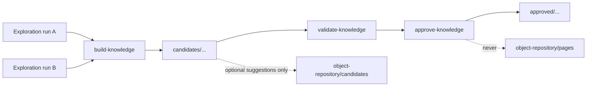

# Phase 4C — Versioned application knowledge

Convert multiple Phase 4B exploration runs into a deterministic, reviewable
application state graph while preserving separation between **candidates** and
**approved** knowledge (and never auto-promoting Page Objects).

## Directory model

```
automation/knowledge/
  candidates/<applicationId>/<buildFingerprint>/<knowledgeRunId>/
    application-knowledge.json
    state-graph.json
    workflows.json
    coverage.json
  approved/<applicationId>/<buildFingerprint>/
    application-knowledge.json
    state-graph.json
    workflows.json
    coverage.json
    knowledge-approval.json
```

Candidate contents are gitignored. Approved knowledge is tracked only when
sanitized and intentionally reviewed.

## Schemas

| Schema | Role |
|---|---|
| `application-knowledge.schema.json` | Envelope: fingerprint, sources, graph, coverage, approval |
| `application-state-graph.schema.json` | Windows, states, elements, transitions, dialogs |
| `application-workflow.schema.json` | Ordered successful transition sequences |
| `knowledge-approval.schema.json` | Human review record (`promotesPageObjects: false`) |



## Fingerprinting

A knowledge version is identified by `applicationId` + `buildFingerprint`.

Fingerprint fields:

| Field | Notes |
|---|---|
| `applicationId` | Stable app slug |
| `executablePath` | From exploration policy when present |
| `productVersion` / `fileVersion` | When available via config identity |
| `executableSha256` | When configured/readable |
| `configIdentity` | Relevant config/env **without secrets** |
| `driverVersion` | When known |
| `snapshotSchemaVersion` | Semantic snapshot contract |
| `explorerVersion` | Exploration artifact contract (`phase4b-1`) |
| `explorationPolicyHash` | Policy SHA-256 |

**Incompatible fingerprints are never silently merged.** A fingerprint change
starts a new knowledge version under a new `buildFingerprint` path.

## Stable IDs

Deterministic IDs are hashed from normalized semantic content:

- Exclude runtime refs, HWNDs, coordinates, timestamps, ordinal/depth suffixes
- Element IDs prefer `AutomationId` + `ControlType` (+ `ClassName`) over Name-only
- Collisions are detected and reported in `idCollisions`
- Content hashes for approval/compare exclude volatile first/last observed timestamps

## Merge rules

1. Validate exploration artifacts before merge
2. Sort runs by `explorationId` (deterministic; order-independent input)
3. Identical normalized transitions increase `observationCount` + evidence
4. Conflicting transitions (same source+action, different target/outcome) remain
   explicit distinct edges sharing a `conflictGroupId`
5. Missing controls in a later run do **not** auto-delete prior knowledge
6. Build-fingerprint mismatch rejects the merge

## Candidate / approved separation

| Action | Candidate | Approved | Page Objects |
|---|---|---|---|
| `build-knowledge` | writes | no | optional suggestions under `candidates/` only |
| `approve-knowledge` | reads | writes | **never** promotes |
| Active `pages/` / `repository.json` | untouched | untouched | untouched |

## CLI (offline — no driver / network)

```cmd
dotnet run --project src/DesktopAutomationAgent -- build-knowledge --application-id demo-app --exploration-run <id> --exploration-run <id2> --json
dotnet run --project src/DesktopAutomationAgent -- validate-knowledge --path <knowledge-dir> --json
dotnet run --project src/DesktopAutomationAgent -- compare-knowledge --left <a> --right <b> --json
dotnet run --project src/DesktopAutomationAgent -- search-knowledge --path <knowledge-dir> --query open --json
dotnet run --project src/DesktopAutomationAgent -- approve-knowledge --source <candidate-dir> --reviewer alice --reviewed-input approval.json --json
```

`search-knowledge` is **deterministic lexical search only** (no embeddings / vector DB).

`approve-knowledge` requires:

- `--reviewed-input` JSON with `decision=approve`
- matching `sourceKnowledgeHash` (content hash excluding volatile timestamps)
- matching `--reviewer`
- `promotesPageObjects: false` (always)

## Coverage meanings

| Field | Meaning |
|---|---|
| `windows` | Distinct semantic windows |
| `uniqueStates` | Distinct state fingerprints |
| `actionableElements` | Elements with locator evidence |
| `permittedTransitionsAttempted` | Sum of transition observation counts |
| `successfulTransitions` | success / newWindow / closedWindow / modalDialog observations |
| `noOpTransitions` | no-op observations |
| `failedTransitions` | failure / scope / timeout / stale observations |
| `deniedSamples` | Denied action samples from exploration summaries |
| `unresolved` | Unresolved + ambiguous elements |
| `conflicts` | Transition edges in a conflict group |
| `truncationOrBudgetLimits` | Stop reasons / budget warnings |

## Object repository protection

- Suggestions go only to `object-repository/candidates/`
- Never writes `object-repository/pages/`
- Never modifies `repository.json`
- Approved object refs may be linked from knowledge only after separate human validation

## Limitations

- No AI / embeddings / vision
- No automatic Page Object promotion
- No silent rebuild across incompatible builds
- WinForms window class names are normalized by stripping runtime `.app.*` suffixes
- Product/file version enrichment depends on optional config identity keys
- Workflow extraction covers successful navigation sequences only
- Knowledge merge does not re-query the live UI
