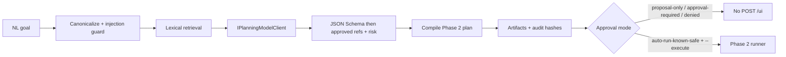

# Phase 6 — Guarded AI Semantic Planner and Retrieval

Phase 6 turns a natural-language testing goal into a **candidate Phase 2 plan**
through a guarded pipeline. The model never calls `DesktopAutomationDriver`.



## Boundaries

| Allowed | Forbidden |
|---|---|
| Retrieve small approved knowledge / PO / step / op subsets | Entire UIA trees, secrets, editable values, customer data |
| Typed JSON plan proposals | Model-selected unrestricted exploration |
| Deterministic validate / compile | Self-healing, vision/OCR, repo auto-update |
| Fake deterministic model in CI | Provider credentials in plans or UI/Jira text |
| Explicit `--execute` after auto-run-known-safe | Proposal-only execution; validator bypass |

`DesktopAutomationDriver` has **no** planning/provider dependency.

## Provider

- Interface: `IPlanningModelClient`
- Default / CI: `FakePlanningModelClient` (`Planning:Provider=fake`)
- Credentials only from env/secret config (`Planning:ApiKeyEnvironmentVariable`)
- Bounded timeout, token/output budgets, and cancellation

## Retrieval

Deterministic lexical search + filters first (embeddings optional, never source of truth):

- Approved knowledge under `knowledge/approved/...`
- Object repository pages
- Step registry mappings
- Operation catalog (offline file or minimal safe catalog)

Retrieval records IDs + content hashes in `retrieval-manifest.json`.
Prompt context is budgeted structurally (drop lowest-ranked hits / shorten snippets)
so the serialized retrieval JSON remains parseable — never mid-string truncated.
Registry/catalog/knowledge reads use link-aware containment (`PlanningPathSafety`).

## Proposal schema

Checked-in: `automation/schemas/plan-proposal.schema.json`.

`PlanningProposalValidator` evaluates that schema with **Json.Schema before**
deserialization. `PlanProposalDocument` does not default `risk` or `schemaVersion`
to security-sensitive values; missing/null required arrays and oversized strings fail.

Required: goal, assumptions, unresolvedQuestions, ordered steps, object/knowledge refs,
expected state/postcondition, risk. Confidence is **metadata only** and never
authorizes execution. Malformed / extra / unknown / prohibited / ambiguous /
unsupported proposals are rejected.

## Approval modes

| Mode | Behavior |
|---|---|
| `proposal-only` (default) | Never executes / never `POST /ui` |
| `auto-run-known-safe` | Only catalog **read/query** (or explicit safe allowlist) with **retrieved** mapping/object refs and **no raw locators**; still needs `--execute` |
| `approval-required` | Mutations / invoke / input / data entry / transactional / uncertain — candidate may exist, no auto-run |
| `denied` | Destructive / prohibited / unresolved / injection / hallucinated / stale |

Model `risk:"low"` alone never authorizes auto-run. Catalog `category` /
`operationType` and retrieval hits are authoritative.

## Prompt injection

UI / Jira / app text is untrusted. System policy is not overridable. Requests for
credentials, shell, filesystem, network, or unrestricted driver access are rejected.
Embedded UI/Jira policy overrides fail closed before the model path proceeds.

## Artifacts

```
automation/planning/<planningId>/
  request-summary.json
  retrieval-manifest.json
  proposal.json
  validation.json
  candidate.plan.json
```

Redacted, bounded, non-overwriting (atomic temp + move). Writes are confined under
`planning/` with junction/symlink escape rejection. Full provider payloads are
not persisted unless a sanitized fixture. `automation/planning/.gitignore` is
UTF-8/LF and ignores generated run artifacts while keeping `evals/` and README.

## CLI

```cmd
dotnet run --project src/DesktopAutomationAgent -- propose-plan --goal "List visible windows" --json
dotnet run --project src/DesktopAutomationAgent -- propose-plan --goal "..." --knowledge knowledge/approved/<app>/<fp> --catalog planning/evals/catalog.json --json
```

## Eval set

Sanitized cases under `automation/planning/evals/`. CI uses the fake model.
Exit gate: valid goals produce candidates; unsafe / ambiguous / hallucinated /
stale / injected cases cannot reach the driver. Re-review coverage includes
mutation/raw-locator auto-run denial, schema omit/null/oversized rejection,
structural prompt budget, and path junction/chained-link escapes.

## Out of scope

Self-healing, model-selected unrestricted exploration, repo auto-update, vision/OCR.