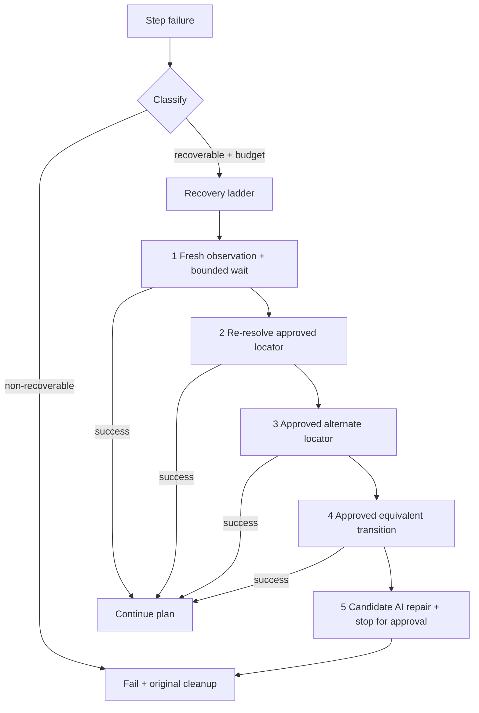

# Phase 7 — Bounded Execution Recovery

Phase 7 recovers from **limited, classified** runtime drift during deterministic
plan execution. It is **not** unrestricted self-healing: the original plan hash,
approved Page Objects, approved knowledge, and the step registry are never
silently rewritten.



## Recoverable classifications

| Classification | Meaning |
|---|---|
| `state-not-stable` | Timing drift / element not ready yet |
| `expected-child-window-not-active` | Expected dialog/child not yet active |
| `approved-alternate-locator` | Primary missing; approved alternate may resolve uniquely |
| `approved-equivalent-transition` | Approved knowledge maps to an equivalent path |
| `explicitly-approved-candidate-locator` | Previously reviewed candidate locator is available |

## Not automatically recoverable

| Classification | Meaning |
|---|---|
| Assertion / business-result failure | Never healed |
| Authentication / authorization | Never healed |
| Destructive-action denial | Never healed |
| Ambiguous locator | Stops; no guess |
| Application build mismatch without approved knowledge | Stops |
| Unexpected external process/window | Stops |
| Unknown operation | Stops |
| Compile / schema failure | Stops |
| Repeated failure after budget | Stops |

## Recovery ladder

1. Fresh observation evidence + **one** bounded wait when policy permits, then re-execute.
2. Re-resolve the same approved locator/object.
3. Try an existing **approved** alternate locator (`alternateLocators` on the Page Object) after unique `finduia` verification.
4. Use an existing **approved** equivalent knowledge transition/path.
5. Generate a **candidate** AI repair proposal under `object-repository/candidates/recovery/` and **stop for approval**.
6. Fail and execute the original `onFailureSteps` cleanup (unchanged, no recovery during cleanup).

## Budgets (`Recovery` settings)

| Setting | Default | Role |
|---|---|---|
| `Enabled` | `true` | Master switch (false = Phase 2 fail-fast) |
| `MaxTotalRecoveriesPerRun` | `5` | Cap across the run |
| `MaxRecoveryAttemptsPerStep` | `3` | Cap per step |
| `MaxAdditionalDurationSeconds` | `60` | Extra wall-clock budget |
| `BoundedWaitMilliseconds` | `750` | Tier-1 wait |
| `Provider` | `fake` | CI must use fake |

Additional hard rules:

- **No recursive recovery** (a recovery attempt cannot start another).
- **No recovery during cleanup** unless a future deterministic policy is added separately.
- Confidence metadata never authorizes execution or promotion.

## Artifacts

Under `automation/runs/<runId>/recovery/`:

- Snapshots before/after recovery attempts
- Per-attempt records (classification, tier, outcome)
- `recovery-summary.json` with **original immutable plan hash**, tier used, candidate path, final result

The original plan file and its SHA-256 remain unchanged. A repaired future plan
requires a **separate reviewed** artifact/version.

## Candidate repairs and approval workflow

1. Fake (CI) or registered provider emits a candidate repair proposal.
2. Writer stores it only under `object-repository/candidates/recovery/<proposalId>/`.
3. Proposal includes evidence, confidence, old/new locators, application fingerprint,
   and a reproducible verification command.
4. **Never auto-promoted** into `object-repository/pages/`, approved knowledge, or the step registry.
5. Unique verification is required before human approval and promotion.

## Configuration

```json
"Recovery": {
  "Enabled": true,
  "MaxTotalRecoveriesPerRun": 5,
  "MaxRecoveryAttemptsPerStep": 3,
  "MaxAdditionalDurationSeconds": 60,
  "BoundedWaitMilliseconds": 750,
  "Provider": "fake"
}
```

## Limitations

- Recovery cannot invent locators into the active repository.
- Ambiguous matches stop; they are never guessed.
- Assertion and destructive failures are never healed.
- Build/fingerprint mismatch without approved knowledge stops.
- Unexpected external windows/processes are out of scope for auto-recovery.
- This phase does **not** market or implement unrestricted self-healing.

## Exit gate

Only explicitly recoverable controlled failures may recover, within budget, while
the original plan and approved repositories remain unchanged.
