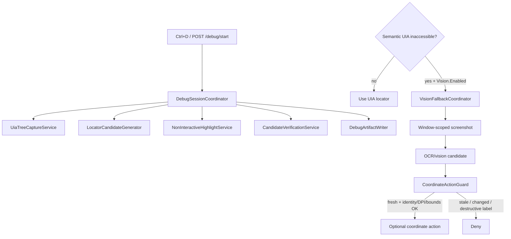

# Phase 8 — Debug Mode and vision fallback

Phase 8 adds **developer-assisted UIA inspection** (Debug Mode) and a **carefully
bounded visual fallback** for inaccessible / custom-drawn controls. Vision never
replaces working UIA locators. Candidates are never auto-promoted.



## Interactive desktop requirement

Coordinate actions, hover probes, visual highlighting, and screenshot workflows
require a **rendered, interactive Windows desktop** (or a supported virtual
display with an interactive session). Phase 8 does **not** claim headless support.

## Debug Mode services

Feature logic is isolated per `docs/debug-mode-design-boundaries.md`.
`RecordingOverlayWindow` / `UiService` remain UI/menu coordinators only
(thin Ctrl+D + status forwarding).

| Service | Responsibility |
|---|---|
| `DebugSessionCoordinator` | Start/stop/toggle, inspect orchestration, gated vision fallback |
| `UiaTreeCaptureService` | Bounded ancestry / children / patterns |
| `LocatorCandidateGenerator` | Object-repository / Phase 3 locator rules |
| `NonInteractiveHighlightService` | Yellow click-through highlight |
| `CandidateVerificationService` | Unique vs ambiguous verification (live probe only) |
| `DebugArtifactWriter` | Candidate artifacts only (`debug-candidates/`) |

### Behavior

- Explicit start/stop and **Ctrl+D**
- Inspect under cursor **without clicking**
- Yellow highlight does **not** intercept clicks
- Candidate artifacts only; `autoPromoted=false`; human approval required
- Live locator probe: **probe unavailable** ≠ zero-match; never invent unique from stale in-memory capture
- HTTP: `GET/POST /debug/status|start|stop|toggle|inspect|verify|hover|doubleclick-allowed`

## Vision fallback (production path)

Disabled by default (`Vision:Enabled=false` in `appsettings.json` / env).

Bound via `IOptions<VisionFallbackOptions>` and exposed at:

| HTTP | Purpose |
|---|---|
| `GET /vision/status` | Enabled flag + options |
| `POST /vision/evaluate` | Eligibility for a semantic target |
| `POST /vision/candidates` | `TryProduceCandidates` (no-op when disabled) |
| `POST /vision/authorize` | `AuthorizeCoordinateAction` |
| `POST /vision/hover` | Gated hover authorization |
| `POST /vision/doubleclick` | DoubleClickPolicy + gated authorize |

When Debug Mode inspects an inaccessible target and Vision is enabled,
`DebugSessionCoordinator` also produces vision candidates on the session snapshot
(real app fallback for Scenario 5 / CustomDrawnCanvas).

Allowed only when:

1. Vision is enabled, and
2. Semantic UIA reports inaccessible **or** policy explicitly permits

Rules:

- Window-scoped screenshots (not unrestricted desktop)
- OCR/vision output is a **candidate** with confidence + bounds
- Revalidate window identity (**HWND + PID required**), DPI/scale, **full candidate bounds + click point inside window**, and freshness before coordinates
- Never reuse saved coordinates after window/layout change
- Destructive **actions and candidate labels** (Delete/Pay/Purchase/Submit/…) denied even for `Action=click`
- Sensitive screenshots are not persisted by default; text may be redacted

Fake provider (`Provider=fake`) is required in CI.

## Hover / double-click

- **Hover** is a mouse probe, not a UIA capability (`POST /debug/hover`, `POST /vision/hover`).
- **Double-click** requires policy or known behavior (`POST /debug/doubleclick-allowed`, `POST /vision/doubleclick`).

## Configuration

```json
"Vision": {
  "Enabled": false,
  "AllowWhenUiaInaccessible": true,
  "AllowWhenPolicyPermits": false,
  "MaxScreenshotAgeMilliseconds": 1500,
  "PersistSensitiveScreenshots": false,
  "Provider": "fake",
  "MinimumConfidence": 0.6
}
```

## Artifacts

- Debug candidates: `<output>/debug-candidates/<sessionId>/candidate.json`
- Never written under approved `object-repository/pages/`

## Custom-drawn fixture

`DesktopAutomationTestApp` includes `CustomDrawnCanvas` with **empty** WinForms
`Name` / `AccessibleName` (find via parent `UiIds.CustomDrawnGroup`). Empty
AutomationId+Name on Custom/Pane satisfies the Phase-8 inaccessibility rule.
Do **not** set `Name = CustomDrawnCanvas` — that made the control accessible.

## Windows acceptance

Prior 9/9 PASS on tip `28b8712` is **retracted** (HTTP inspect/stop failed).
Re-run S1–S9 is **DNU-23**. Helper: `docs/acceptance/phase8-assert-http-ok.ps1`.
Do not claim PASS until `startHttpOk` / `inspectHttpOk` / `verifyHttpOk` / `stopHttpOk` are true.

## Limitations

- Real OCR providers are not enabled in Phase 8 (fake only)
- No headless claim
- Vision remains independently gated from Debug Mode
- Manual Windows acceptance required before leaving draft / merge

## Exit gate

Debug capture and visual fallback must work on controlled fixtures without
intercepting clicks, persisting sensitive screenshots by default, or promoting
any candidate automatically.
