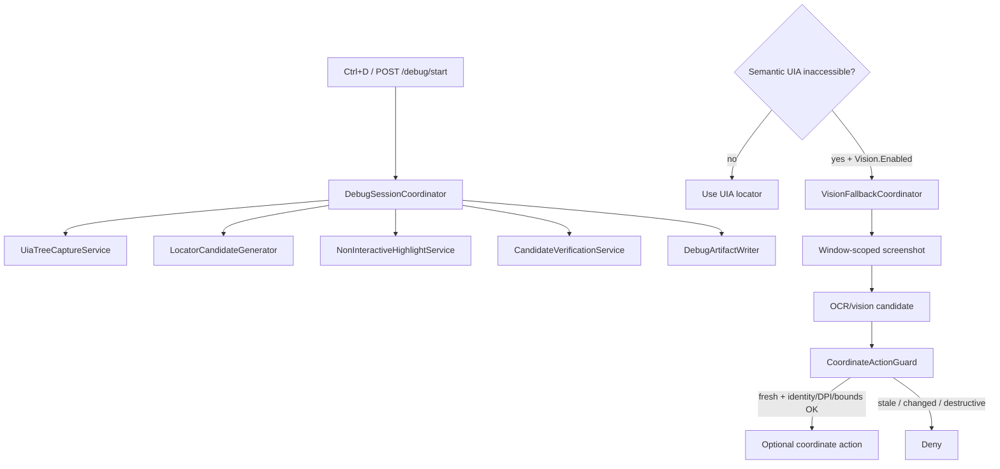

# Phase 8 — Debug Mode and vision fallback

Phase 8 adds **developer-assisted UIA inspection** (Debug Mode) and a **carefully
bounded visual fallback** for inaccessible / custom-drawn controls. Vision never
replaces working UIA locators. Candidates are never auto-promoted.



## Interactive desktop requirement

Coordinate actions, hover probes, visual highlighting, and screenshot workflows
require a **rendered, interactive Windows desktop** (or a supported virtual
display with an interactive session). Phase 8 does **not** claim headless support.

## Debug Mode services

Feature logic is isolated per `docs/debug-mode-design-boundaries.md`.
`RecordingOverlayWindow` / `UiService` remain UI/menu coordinators only
(thin Ctrl+D + status forwarding).

| Service | Responsibility |
|---|---|
| `DebugSessionCoordinator` | Start/stop/toggle, inspect orchestration |
| `UiaTreeCaptureService` | Bounded ancestry / children / patterns |
| `LocatorCandidateGenerator` | Object-repository / Phase 3 locator rules |
| `NonInteractiveHighlightService` | Yellow click-through highlight |
| `CandidateVerificationService` | Unique vs ambiguous verification |
| `DebugArtifactWriter` | Candidate artifacts only (`debug-candidates/`) |

### Behavior

- Explicit start/stop and **Ctrl+D**
- Inspect under cursor **without clicking**
- Yellow highlight does **not** intercept clicks
- Candidate artifacts only; `autoPromoted=false`; human approval required
- HTTP: `GET/POST /debug/status|start|stop|toggle|inspect|verify`

## Vision fallback

Disabled by default (`Vision:Enabled=false` / `VisionFallbackOptions.Enabled=false`).

Allowed only when:

1. Vision is enabled, and
2. Semantic UIA reports inaccessible **or** policy explicitly permits

Rules:

- Window-scoped screenshots (not unrestricted desktop)
- OCR/vision output is a **candidate** with confidence + bounds
- Revalidate window identity, DPI/scale, bounds, and freshness before coordinates
- Never reuse saved coordinates after window/layout change
- Destructive actions remain denied
- Sensitive screenshots are not persisted by default; text may be redacted

Fake provider (`Provider=fake`) is required in CI.

## Hover / double-click

- **Hover** is a mouse probe, not a UIA capability. Record tooltip / structure /
  state changes and no-op outcomes (`HoverProbeRules`, `HoverProbeResult`).
- **Double-click** requires policy or known behavior (`DoubleClickPolicy`). Do not
  infer it for every list/grid item.

## Configuration

```json
"Vision": {
  "Enabled": false,
  "AllowWhenUiaInaccessible": true,
  "AllowWhenPolicyPermits": false,
  "MaxScreenshotAgeMilliseconds": 1500,
  "PersistSensitiveScreenshots": false,
  "Provider": "fake",
  "MinimumConfidence": 0.6
}
```

## Artifacts

- Debug candidates: `<output>/debug-candidates/<sessionId>/candidate.json`
- Never written under approved `object-repository/pages/`

## Custom-drawn fixture

`DesktopAutomationTestApp` includes `CustomDrawnCanvas` (`UiIds.CustomDrawnCanvas`)
with weak UIA identity for Windows acceptance of vision/debug paths.

## Limitations

- Real OCR providers are not enabled in Phase 8 (fake only)
- No headless claim
- Vision remains independently gated from Debug Mode
- Manual Windows acceptance (WPF/WinForms + custom-drawn) required before
  leaving draft

## Exit gate

Debug capture and visual fallback must work on controlled fixtures without
intercepting clicks, persisting sensitive screenshots by default, or promoting
any candidate automatically.
